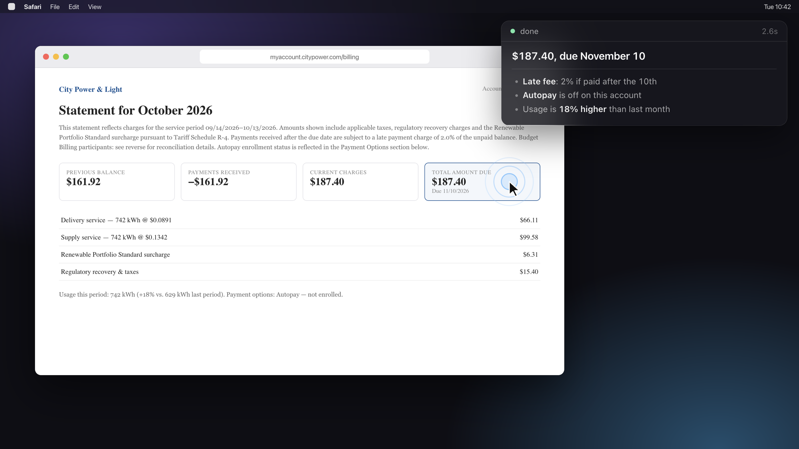
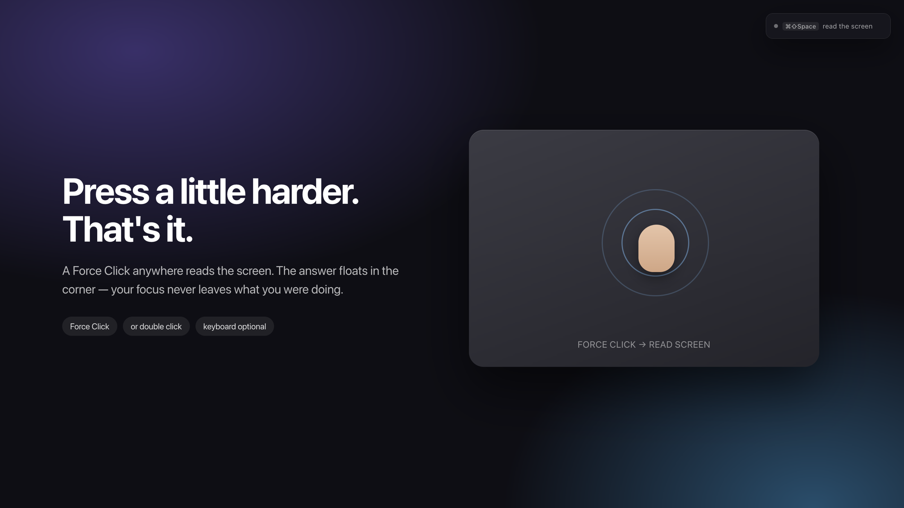
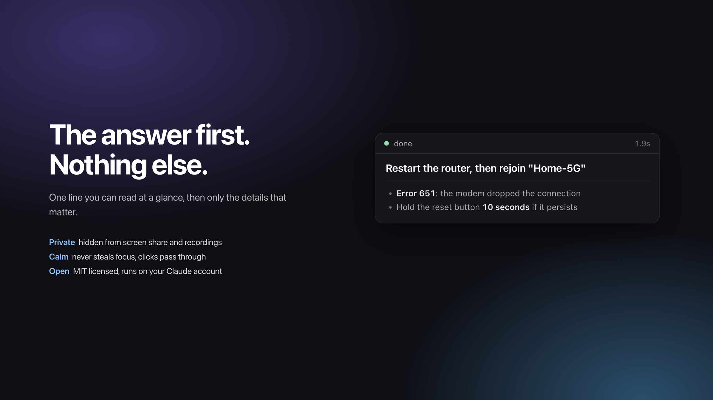

# glance

**Look at it. Click. Understand it.**

glance is an open-source macOS assistant that reads your screen and answers in one line. Force Click the trackpad and a small panel in the corner tells you what matters — a bill's due date, how to take a medicine, what an error means — without moving your focus or touching the keyboard.

It started as a research project on assistive technology at [IFSP](https://www.ifsp.edu.br/) (Control and Automation Engineering), aimed at people for whom keyboard shortcuts, dense text or long explanations are a barrier.



## Features

- **Trackpad trigger.** A Force Click (or a double click) anywhere reads the screen. Keyboard shortcuts work too, but they're optional.
- **Answer first.** The first line is the answer, in a few words. Up to three short bullets follow, only when they add something.
- **Sized to the answer.** The panel grows to fit the response and nothing more, anchored to the top-right corner.
- **Never in the way.** It never takes focus from the app you're using, and clicks pass straight through it.
- **Private.** The panel is excluded from screen sharing and recordings, so your assistant stays yours during calls.
- **No API key.** It runs on your logged-in Claude Code account through the official [Claude Agent SDK](https://www.npmjs.com/package/@anthropic-ai/claude-agent-sdk).



## Install

1. Install [Claude Code](https://claude.com/claude-code) and log in once by running `claude` in a terminal. glance uses it to talk to Claude, so there's no API key to set up.
2. Download the DMG for your Mac from the [latest release](https://github.com/rafae2k/glance/releases/latest): `arm64` for Apple Silicon (M1 and later), `x64` for Intel.
3. Open the DMG and drag **glance** into Applications.
4. **First launch:** the app isn't notarized by Apple yet, so macOS will block it. Open it once, then go to System Settings → Privacy & Security and click **Open Anyway**. Or run:

   ```bash
   xattr -dr com.apple.quarantine /Applications/glance.app
   ```

A small pill appears in the top-right corner. See [Permissions](#permissions) for the two macOS prompts.

## Run from source

Requirements:

- macOS 12+ with a Force Touch trackpad (for the Force Click trigger)
- Node.js 20+
- Xcode Command Line Tools (`xcode-select --install`) — for `swiftc`, which builds the trackpad helper
- [Claude Code](https://claude.com/claude-code), installed and logged in

```bash
git clone https://github.com/rafae2k/glance.git
cd glance
npm install
npm start
```

The first `npm start` compiles the trackpad helper into `bin/`.

To build the DMGs yourself (output in `dist/`):

```bash
npm run dist
```

## Permissions

The first time you trigger glance, macOS asks for **Screen Recording**. Enable it for **glance** (or **Electron** when running from source) in System Settings → Privacy & Security → Screen Recording, then restart the app. If Force Click does nothing, also allow it under **Input Monitoring**.

**Force Click and Look Up.** By default macOS also uses Force Click for "Look up & data detectors". To avoid both firing at once, go to System Settings → Trackpad and switch it to "Tap with three fingers" or turn it off.

## Usage

| Action | Trackpad | Keyboard |
| --- | --- | --- |
| Read the screen | Force Click | `⌘⇧Space` |
| Scroll the answer | — | `⌘⇧↓` / `⌘⇧↑` |
| Show / hide | — | `⌘⇧H` |
| Quit | — | `⌘⇧Q` |

## Configuration

Set these as environment variables when starting:

| Variable | Default | What it does |
| --- | --- | --- |
| `GLANCE_TRIGGER` | `force` | `force` (Force Click), `double` (double click) or `off` |
| `GLANCE_MODEL` | `sonnet` | Claude model to use, e.g. `opus` |
| `GLANCE_DEBUG` | — | `1` makes the panel visible in screen share and reads the screen on launch |
| `GLANCE_CLAUDE_PATH` | auto | Path to the `claude` binary, if it isn't in a standard location |

```bash
GLANCE_TRIGGER=double GLANCE_MODEL=opus npm start
```

## How it works

```
trackpad ──▶ glance-trigger (Swift, AppKit) ──"trigger"──▶ main.js (Electron)
                                                              │ desktopCapturer
                                                              ▼
                       index.html ◀── streamed text ── bridge.mjs (Claude Agent SDK)
```

| File | Role |
| --- | --- |
| `main.js` | Overlay window, screen capture, shortcuts, spawns the trigger helper |
| `trigger/glance-trigger.swift` | Listens for Force Click / double click system-wide and prints `trigger` |
| `bridge.mjs` | Sends the screenshot to Claude and streams the answer back; holds the system prompt |
| `index.html` | The panel: status bar, answer typography, reports its size to the window |
| `markdown.js` | Tiny Markdown renderer that copes with half-streamed text |
| `preload.js` | IPC bridge between the window and the page |



## Tests

Two manual checks live in `tests/`. Open them in Chrome while glance is running:

- `focus-test.html` — logs every focus, keyboard and clipboard event the page receives. Triggering, scrolling or hiding glance should add nothing.
- `capture-test.html` — mirrors your screen through `getDisplayMedia`. The glance panel shouldn't appear in the mirror (run with `GLANCE_DEBUG=1` to see it appear).

## Regenerating the images

The images in `docs/images` are rendered from the real `index.html`, and the app icon from a small HTML scene:

```bash
npx electron docs/make-images.js . docs/images
npx electron docs/make-icon.js build/icon.png
```

## Contributing

Issues and pull requests are welcome — especially ideas from people who use assistive technology day to day: other triggers (dwell click, Switch Control), reading answers aloud, larger text and high-contrast themes.

## License

[MIT](LICENSE)
